# 慧生活798 · 独立重制客户端

独立重制的中文 Android 客户端，包名 `com.smartlife798.app`，直接访问原服务端 `https://i.ilife798.com`。无官方授权、不含官方源码；界面使用 Kotlin、Jetpack Compose 与 Material 3。

| | |
|---|---|
| 正式版包名 | `com.smartlife798.app` |
| Beta 版包名 | `com.smartlife798.app.debug` |
| 当前版本 | `2.2.13`（`versionCode 93`） |
| 技术栈 | Kotlin 2.2 · Jetpack Compose (Material 3 Expressive) · OkHttp · CameraX + ML Kit · Alipay SDK |
| 最低版本 | Android 7.0（API 24） |
| 正式发布 | [最新 Release](https://github.com/wu-shanglin/Smartlife798/releases/latest) |

客户端发布版本、官方协议请求标识与静态 APK 基线相互独立。运行时从已核验包名和开发者的原应用分发页发现版本，失败保留缓存及内置保底；这不代表新协议或设备兼容性已验，见 [协议维护](docs/04-接口契约与变更检测.md#6-原-apk-版本与更新通道)。

## 当前版本

**2.2.13 / 93**（开发候选）：稳定登录输入框的高度，调整设备详情的全屏展开与连续返回，恢复钱包缩回「我的」入口的过渡。

**2.1.11 / 79** 适配原版 3.1.10 短信登录签名，补齐登录请求的 `sign` 参数。签名通过原版合成向量及离线登录验证，真实账号验收待完成。详见 [登录签名](docs/01-逆向分析报告.md#51-登录与账号)。

**2.1.10 / 78**（已发布）：常用设备详情完全展开后，普通返回和预测性返回均沿原路径缩回打开它的卡片；账单详情恢复 2.1.6 的弹簧曲线、遮罩和 Material 预测性返回缩放；账单点击立即展开摘要并加载详情，修复导航返回拦截；扫码卡片增加留白、缩小文案与减轻内部按钮底色；恢复常用设备紧凑高度、减轻按钮背景层级并美化检查更新入口；统一页面对齐与按钮高度、在线绿色/使用中黄色状态及未选中按钮背景，修复置顶卡片高度、近期记录合并与待付查询账号隔离；详情保留当前来源页并隔离后台刷新，避免快速返回时列表重建；账单左键“暂不支付”只关闭面板并保留待付，真实取消仍需接口依据，见 docs/05。2.0.0 启用全新独立 release 签名，停止支持此前所有版本。旧签名应用无法覆盖升级，请先结束设备使用、核对账单，再卸载旧应用，从正式 Release 页面下载新版安装并重新登录。卸载会删除本机常用/最近/置顶及设置；服务端账号数据以重新登录后的返回为准。新版保留浅色卡片、统一置顶、三页引导及安全镜像更新。

正式更新包及版本说明以 [GitHub 最新 Release](https://github.com/wu-shanglin/Smartlife798/releases/latest) 为准。2.1.11 按强制更新发布，最低支持码为 **79**。低于该版本码的客户端在取得有效策略后须安装更新才能继续使用。

2.x 使用全新证书，1.x（含旧签名的 1.22.0 候选包）不能覆盖安装到 2.x。旧更新器拒绝不同证书的 APK 属于正确保护行为，不能关闭签名校验解决；请按新版 Release 的说明卸载后手动安装。未来 2.x 版本保持新签名连续性。

## 功能与边界

官方直接 NFC 链接及内含明确慧生活小程序设备页的支付宝长格式可经服务端确认进入详情；经确认的 NFC 事件在最新详情就绪后自动尝试开始一次，普通链接保持只打开详情。详情按服务端占用用户区分本人和他人，身份不明、他人占用或状态未就绪时禁用操作，命令前重新核对。现有仅含短码的支付宝中转卡仍未取得设备映射，真实 NFC 天线与整机性能尚待实机验收。

登录、收藏、扫码/手输编号、设备状态与启停、消费账单、钱包充值及支付宝 SDK 已实现；执行、金额和支付结果由服务端决定。支持昵称修改、网络头像、设备「使用积分」账号偏好和默认开启的自动签到（「我的」可关闭，并提供手动签到）。签到结果在当前页面提示，先查询当天状态、提交后读回确认；确认后同日重启跳过自动签到请求及重复提示，跨日重新检查；自动不重发当天不明结果，手动可先查询再明确重试；积分设置已在真机保存并恢复；昵称保存仍待验收；3.1.10 签到已在真机确认实际位图及积分入账。微信支付暂不支持。常用/最近设备、搜索、置顶、启动页和外观偏好属于客户端能力。

范围为中文、手机竖屏；不扩展门禁硬件、考勤、云闪付/银行 SDK 及原应用独立业务。完整页面与功能清单见 [docs/02](docs/02-功能设计与UI方案.md)，已实现不等于真实业务验收通过。

## 维护入口

先读 [AGENTS.md](AGENTS.md)。日常任务按任务分支、验证、Commit、PR/CI、合并及清理执行；打 tag、发布和真实业务操作仍分别授权。

| 需要核对 | 唯一维护位置 |
|---|---|
| 版本历史 | [CHANGELOG](CHANGELOG.md) |
| 原 APK 与协议静态依据 | [docs/01](docs/01-逆向分析报告.md) |
| 页面、交互、视觉与截图来源 | [docs/02](docs/02-功能设计与UI方案.md) |
| 技术选型、运行机制与构建环境 | [docs/03](docs/03-技术方案与开发计划.md) |
| 接口契约、版本发现与漂移检测 | [docs/04](docs/04-接口契约与变更检测.md)、[api-contract.json](docs/api-contract.json) |
| 实测、工程验证及未验边界 | [docs/05](docs/05-真实支付与计费实测.md) |
| 检查命令、存储、发布、待办和 Git | [docs/06](docs/06-工程规范与路线图.md) |

## 构建与产物

2.2.13 为开发候选版本，日常试装使用独立 Debug 包。

唯一 Android 工程为 `SmartLife798/`；先按 [构建与运行](docs/03-技术方案与开发计划.md#4-构建与运行) 准备 JDK/SDK、本机 `local.properties`，再按 [检查与证据](docs/06-工程规范与路线图.md#2-检查与证据) 执行适用检查。release 签名及产物准备见 [版本与发布](docs/06-工程规范与路线图.md#3-版本与发布)。

| 本地构建 | 文件 |
|---|---|
| 产物 | [`dist/SmartLife798-2.2.13-release.apk`](dist/SmartLife798-2.2.13-release.apk) |

日常试装使用 `SmartLife798/app/build/outputs/apk/debug/app-debug.apk`。桌面的「慧生活 798 Beta 版」可与正式版并存，分别保存应用数据。上表是正式发布时的产物路径，只有明确授权打包 Release 并发布后才生成。

原 APK、静态分析缓存、`evidence/` 及 APK 不入库。原样本、签名、本机配置、当前交付和独有证据须保留；清理规则见 [文档与目录维护](docs/06-工程规范与路线图.md#4-文档与目录维护)。

首次引导使用当前主题与 Expressive 按钮；更新时直接展示未读功能卡片，不重播基础卡片，详见 [引导机制](docs/02-功能设计与UI方案.md#首次使用与功能指南)。

## 截图

浅色和深色首页截图来自 2.2.12 / 92 的 API 28 离线构建，设备详情截图来自 2.2.9 / 89；其他主要截图来自 2.1.1 / 69 候选的独立 `.offline` 夹具，使用真实 Compose 页面与终止式传输采集；此前默认字号与窄屏大字完成操作回归，不代表真机帧率、签到、充值或支付验收。提示条保留历史夹具来源。来源与限制见 [截图清单](docs/02-功能设计与UI方案.md#7-界面截图)。

| 首页 | 设备 | 订单 |
|---|---|---|
| 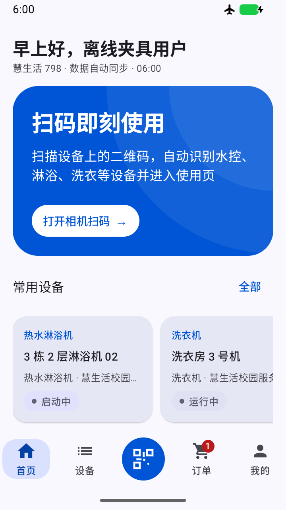 | 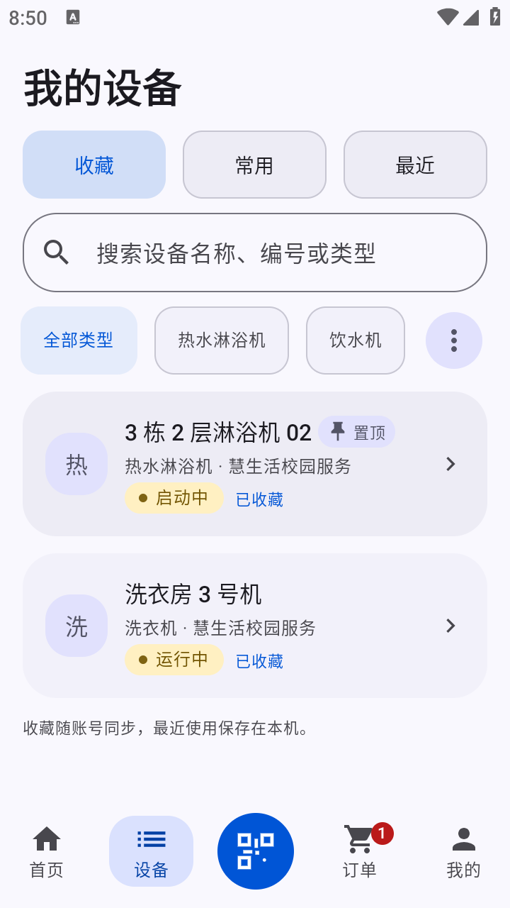 | 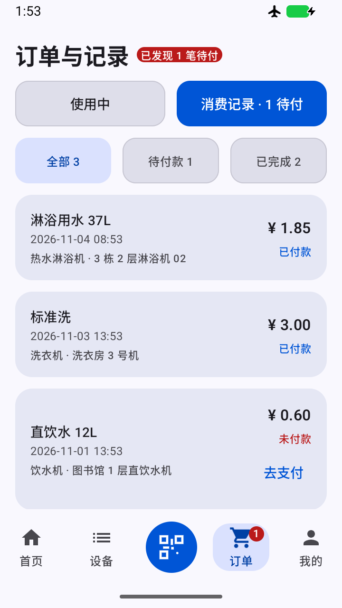 |

| 我的 | 钱包 | 设备详情 |
|---|---|---|
| 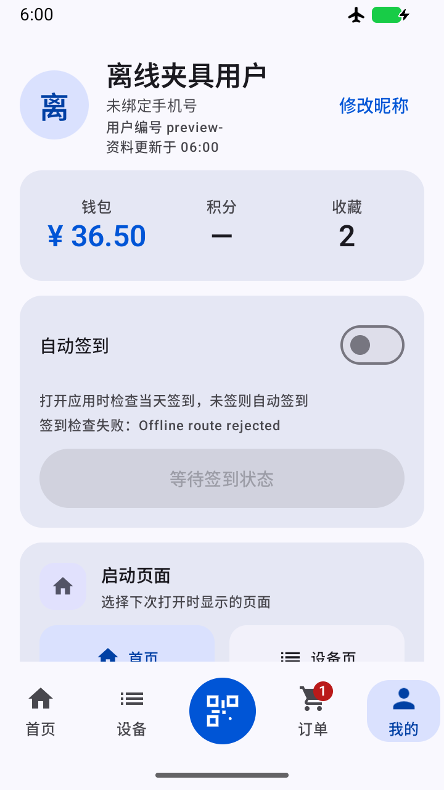 | 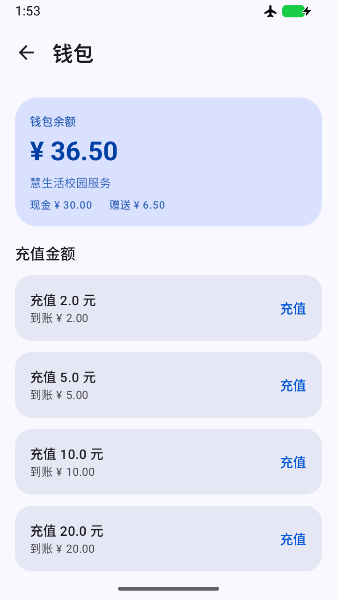 | 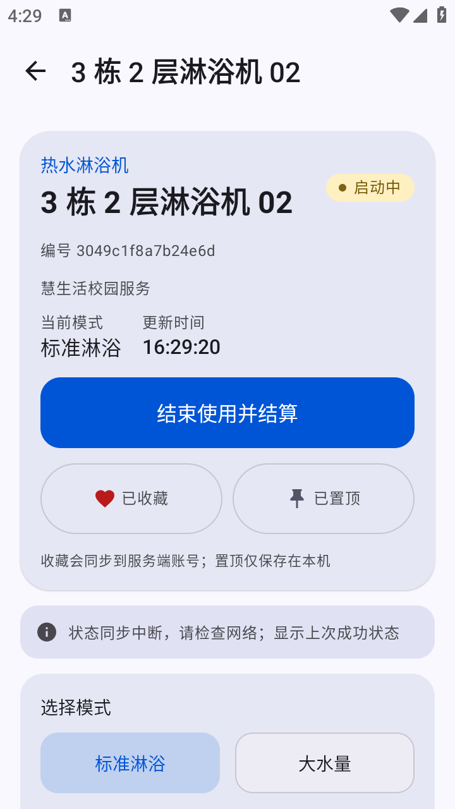 |

| 登录 | 外观设置 | 全局提示条 |
|---|---|---|
| 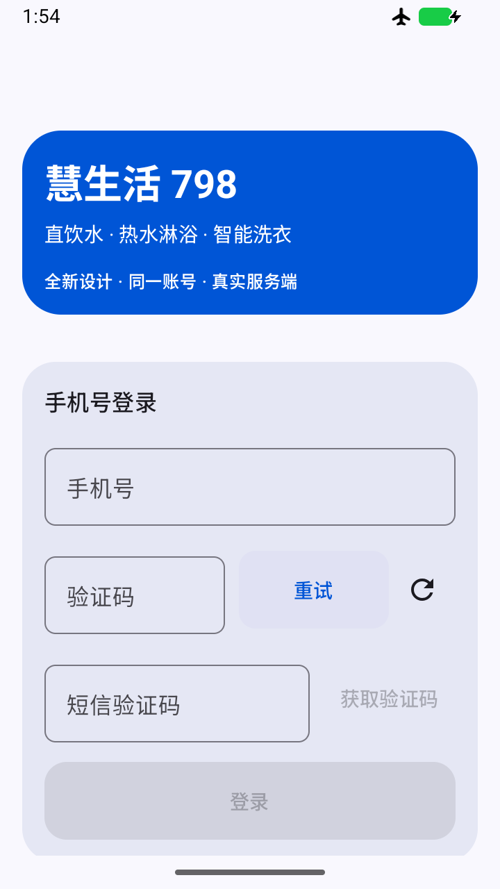 | 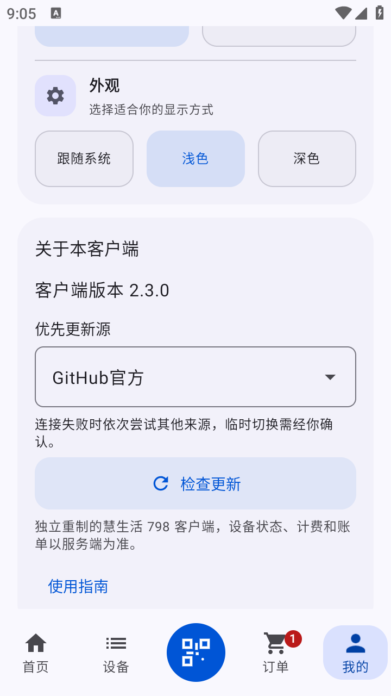 | 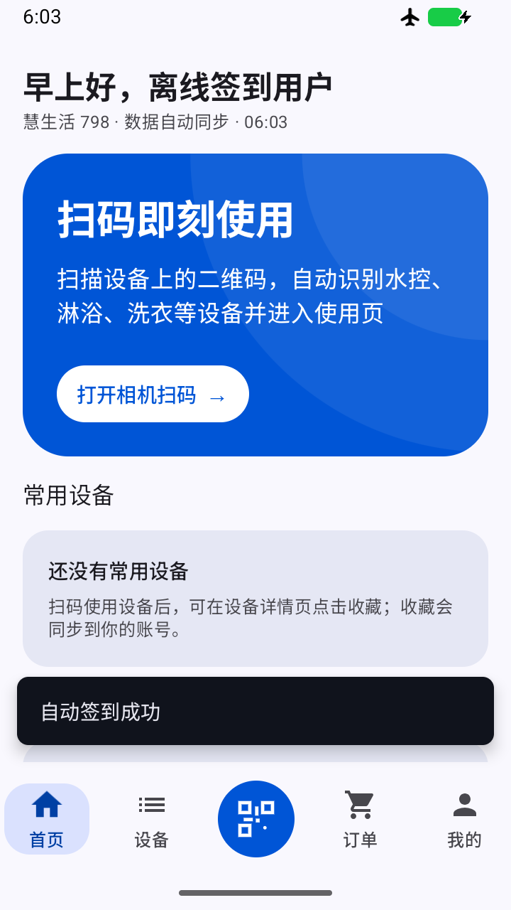 |

| 待付款 | 账单详情 | 支付面板 |
|---|---|---|
| 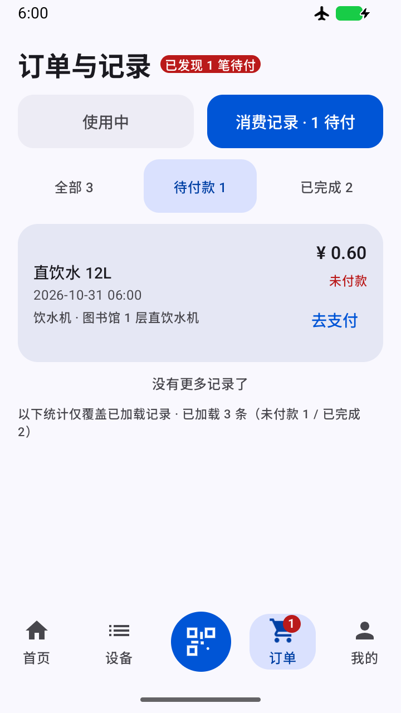 | 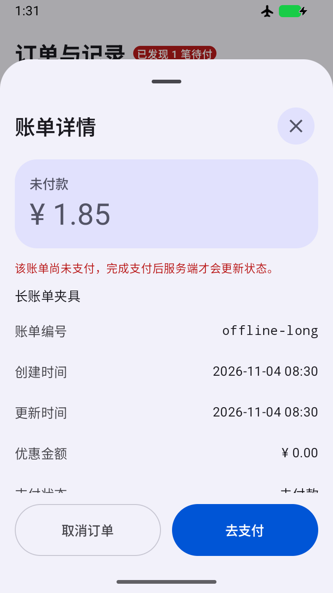 | 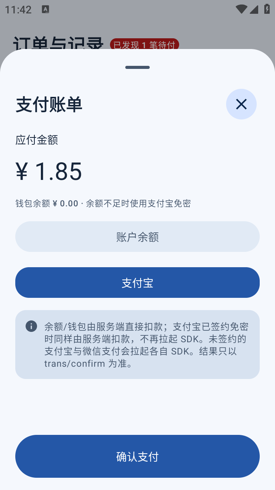 |

| 深色首页 | 深色设置 | 深色支付面板 |
|---|---|---|
| 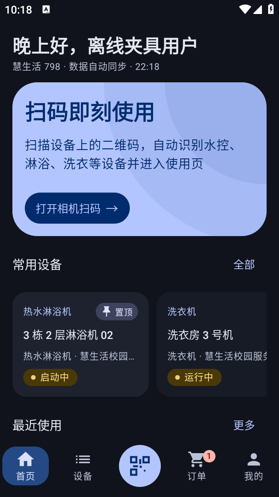 | 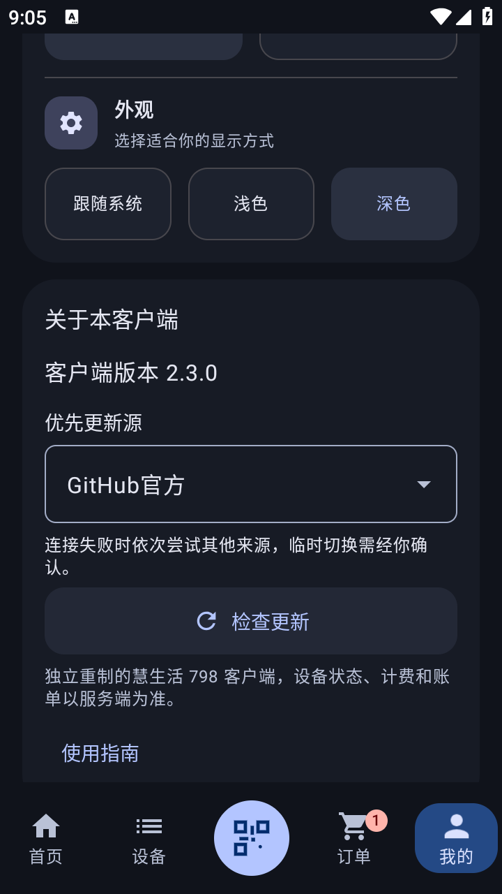 | 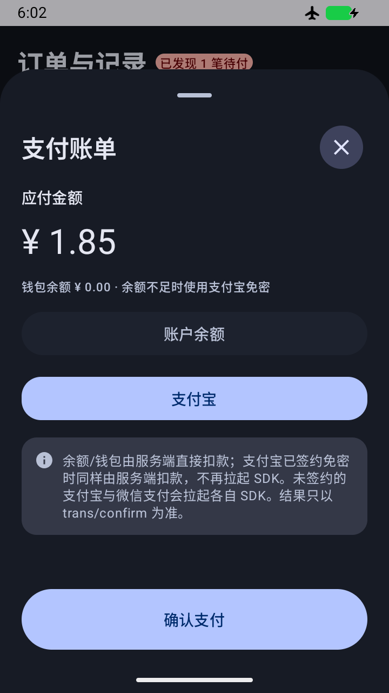 |

扫码与输入界面：[扫码](screenshots/scan.png) · [手动输入](screenshots/manual.png)。

| 首次使用 | 深色引导重看 |
|---|---|
| 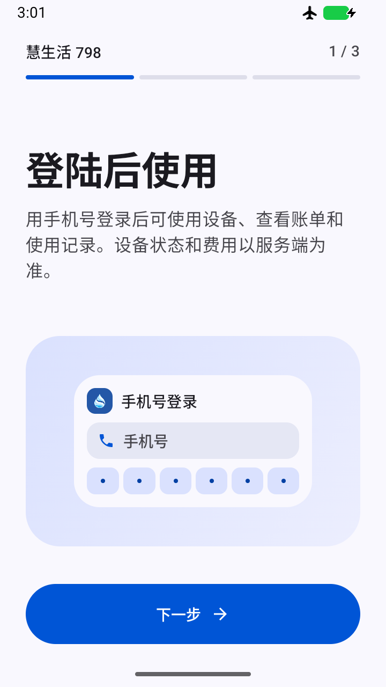 | 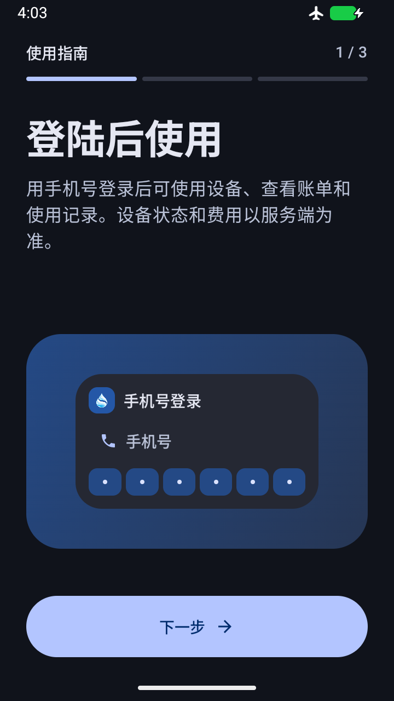 |

| 更新引导 | 开发者工具 |
|---|---|
|  | 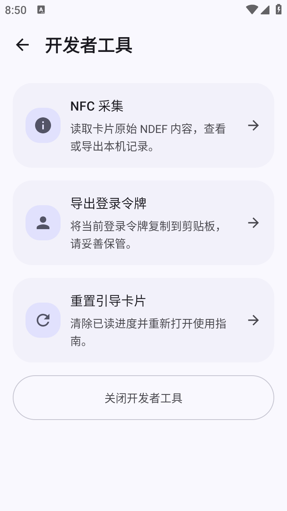 |
