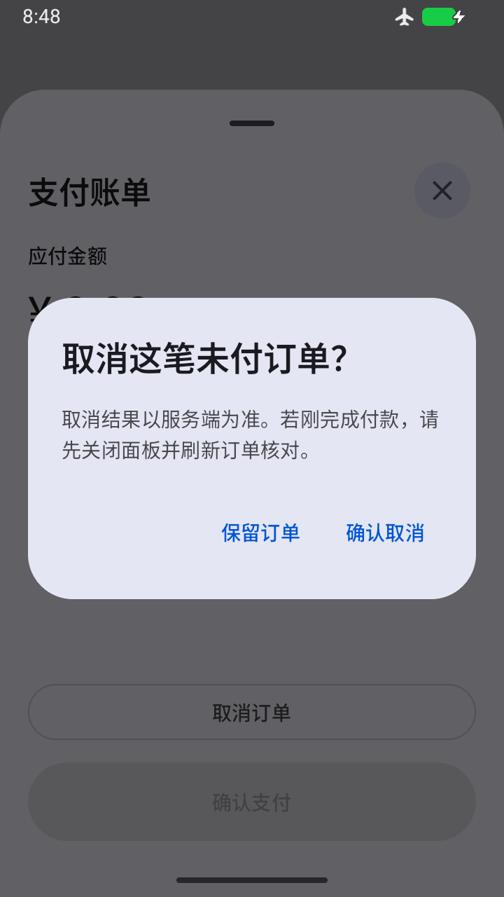

# 慧生活798 · 独立重制客户端

独立重制的中文 Android 客户端，包名 `com.smartlife798.app`，直接访问原服务端 `https://i.ilife798.com`。无官方授权、不含官方源码；界面使用 Kotlin、Jetpack Compose 与 Material 3。

| | |
|---|---|
| 新客户端包名 | `com.smartlife798.app` |
| 当前版本 | `1.21.0`（`versionCode 64`） |
| 技术栈 | Kotlin 2.2 · Jetpack Compose (Material 3 Expressive) · OkHttp · CameraX + ML Kit · Alipay / WeChat SDK |
| 最低版本 | Android 7.0（API 24） |
| 最新已发布 | [1.19.6 APK](https://github.com/wu-shanglin/Smartlife798/releases/download/v1.19.6/SmartLife798-1.19.6-debug.apk) · [Release 说明](https://github.com/wu-shanglin/Smartlife798/releases/tag/v1.19.6) |

客户端发布版本、官方协议请求标识与静态 APK 基线相互独立。运行时从已核验包名和开发者的原应用分发页发现版本，失败保留缓存及内置保底；这不代表新协议或设备兼容性已验，见 [协议维护](docs/04-接口契约与变更检测.md#6-原-apk-版本与更新通道)。

## 当前版本

**1.21.0 / 64**（本地候选，未发布）：首次与新增功能统一全屏引导卡片，开发者工具支持重置引导并采用分组卡片布局；钱包及订单支付面板可显式取消未付交易，取消后须读回服务端状态。微信回调“包名不对”已定位平台身份校验，真实交易仍未打通；实际手机闪屏与帧率待验。

最新公开版本为 **1.19.6 / 62**，普通更新、最低支持码 55（低于 55 的既有版本仍须升级）；公开附件为 APK、update.json 与 release-history.json。[正式 APK](https://github.com/wu-shanglin/Smartlife798/releases/download/v1.19.6/SmartLife798-1.19.6-debug.apk) · [GitHub latest](https://github.com/wu-shanglin/Smartlife798/releases/latest)。

旧客户端若在应用内更新后被厂商安装器提示“相同版本”，可用手机浏览器下载上述正式 APK 并从下载列表打开，覆盖安装一次，无须卸载或清数据。新版本已隔离不同产物的安装 URI；原厂商现场结果仍待确认。

## 功能与边界

官方直接 NFC 链接及内含明确慧生活小程序设备页的支付宝长格式可经服务端确认进入详情；经确认的 NFC 事件在最新详情就绪后自动尝试开始一次，普通链接保持只打开详情。详情按服务端占用用户区分本人和他人，身份不明、他人占用或状态未就绪时禁用操作，命令前重新核对。现有仅含短码的支付宝中转卡仍未取得设备映射，真实 NFC 天线与整机性能尚待实机验收。

登录、收藏、扫码/手输编号、设备状态与启停、消费账单、钱包充值及支付宝/微信 SDK 已实现；执行、金额和支付结果由服务端决定。支持昵称修改、网络头像、设备「使用积分」账号偏好和默认开启的自动签到（「我的」可关闭，并提供手动签到）。签到结果在当前页面提示，先查询当天状态、提交后读回确认；确认后同日重启跳过自动签到请求及重复提示，跨日重新检查；自动不重发当天不明结果，手动可先查询再明确重试；积分设置已在真机保存并恢复；昵称保存仍待验收；3.1.10 签到已在真机确认实际位图及积分入账。微信另受开放平台包名、签名与 appId 配置约束。常用/最近设备、搜索、置顶、启动页和外观偏好属于客户端能力。

范围为中文、手机竖屏；不扩展门禁硬件、考勤、云闪付/银行 SDK 及原应用独立业务。完整页面与功能清单见 [docs/02](docs/02-功能设计与UI方案.md)，已实现不等于真实业务验收通过。

## 维护入口

先读 [AGENTS.md](AGENTS.md)。日常任务按任务分支、验证、Commit、PR/CI、合并及清理执行；打 tag、发布和真实业务操作仍分别授权。

| 需要核对 | 唯一维护位置 |
|---|---|
| 版本历史 | [CHANGELOG](CHANGELOG.md) |
| 原 APK 与协议静态依据 | [docs/01](docs/01-逆向分析报告.md) |
| 页面、交互、视觉与截图来源 | [docs/02](docs/02-功能设计与UI方案.md) |
| 技术选型、运行机制与构建环境 | [docs/03](docs/03-技术方案与开发计划.md) |
| 接口契约、版本发现与漂移检测 | [docs/04](docs/04-接口契约与变更检测.md)、[api-contract.json](docs/api-contract.json) |
| 实测、工程验证及未验边界 | [docs/05](docs/05-真实支付与计费实测.md) |
| 检查命令、存储、发布、待办和 Git | [docs/06](docs/06-工程规范与路线图.md) |

## 构建与产物

唯一 Android 工程为 `SmartLife798/`；先按 [构建与运行](docs/03-技术方案与开发计划.md#4-构建与运行) 准备 JDK/SDK、本机 `local.properties`，再按 [检查与证据](docs/06-工程规范与路线图.md#2-检查与证据) 执行适用检查。可选 release 签名及产物准备见 [版本与发布](docs/06-工程规范与路线图.md#3-版本与发布)。

| 本地构建 | 文件 |
|---|---|
| 产物 | [`dist/SmartLife798-1.21.0-debug.apk`](dist/SmartLife798-1.21.0-debug.apk) |

交付包沿用既有签名，采用非 debuggable 的 performance 构建；附件保留更新通道的历史文件名。

原 APK、静态分析缓存、`evidence/` 及 APK 不入库。原样本、签名、本机配置、当前交付和独有证据须保留；清理规则见 [文档与目录维护](docs/06-工程规范与路线图.md#4-文档与目录维护)。

首次引导使用当前主题与 Expressive 按钮；更新时直接展示未读功能卡片，不重播基础卡片，详见 [引导机制](docs/02-功能设计与UI方案.md#首次使用与功能指南)。

## 截图

首次/更新引导和开发者工具来自 1.21.0，取消确认来自 1.20.0，其余除扫码/手动输入保留历史来源外均为 1.19.6 独立 `.offline` 夹具，使用真实 Compose 页面与终止式传输采集；不代表真实设备、签到、充值或支付验收。来源与限制见 [截图清单](docs/02-功能设计与UI方案.md#7-界面截图)。

| 首页 | 设备 | 订单 |
|---|---|---|
|  |  |  |

| 我的 | 钱包 | 设备详情 |
|---|---|---|
|  |  |  |

| 登录 | 外观设置 | 全局提示条 |
|---|---|---|
|  |  |  |

| 待付款 | 账单详情 | 支付面板 |
|---|---|---|
|  |  |  |

| 深色首页 | 深色设置 | 深色支付面板 |
|---|---|---|
|  |  |  |

历史相机与输入界面：[扫码](screenshots/scan.png) · [手动输入](screenshots/manual.png)。

| 首次使用 | 深色引导重看 | 取消订单确认 |
|---|---|---|
|  |  |  |

| 更新引导 | 开发者工具 |
|---|---|
|  |  |
