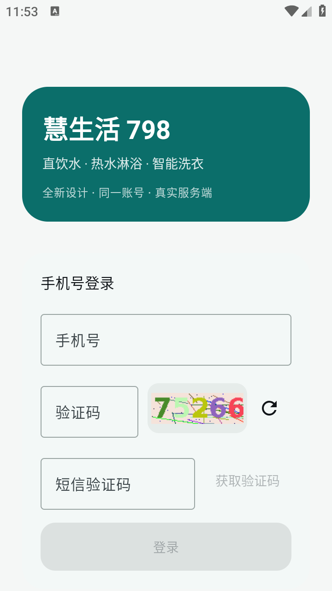
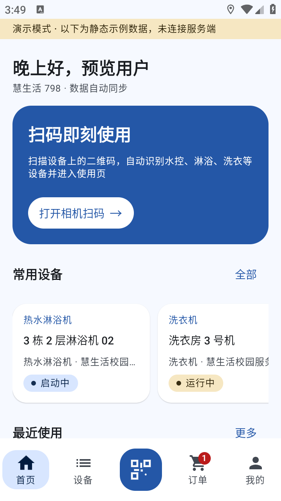
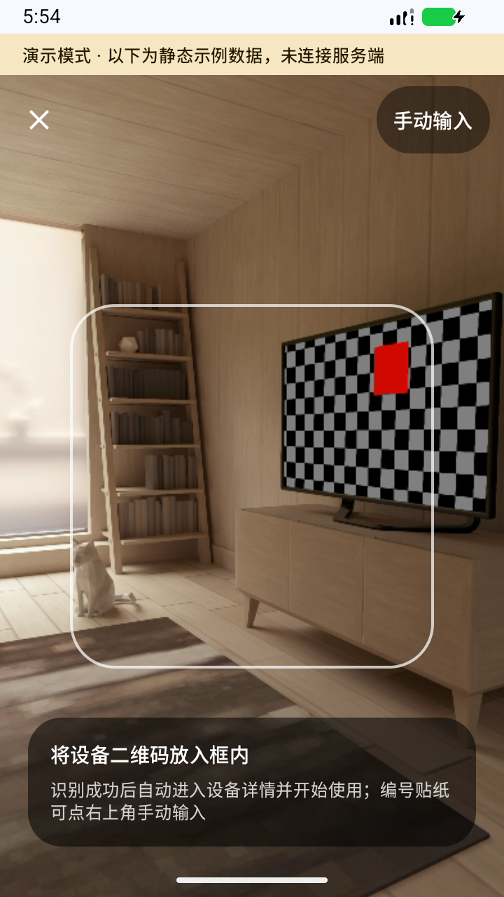
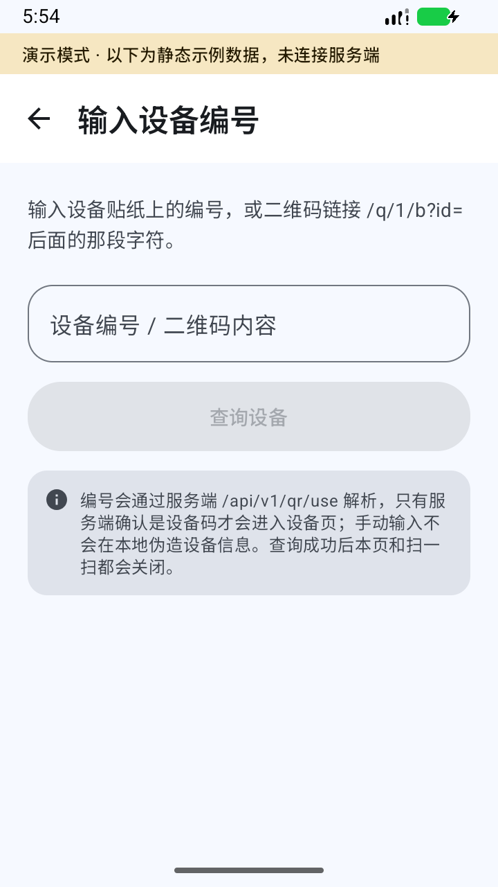
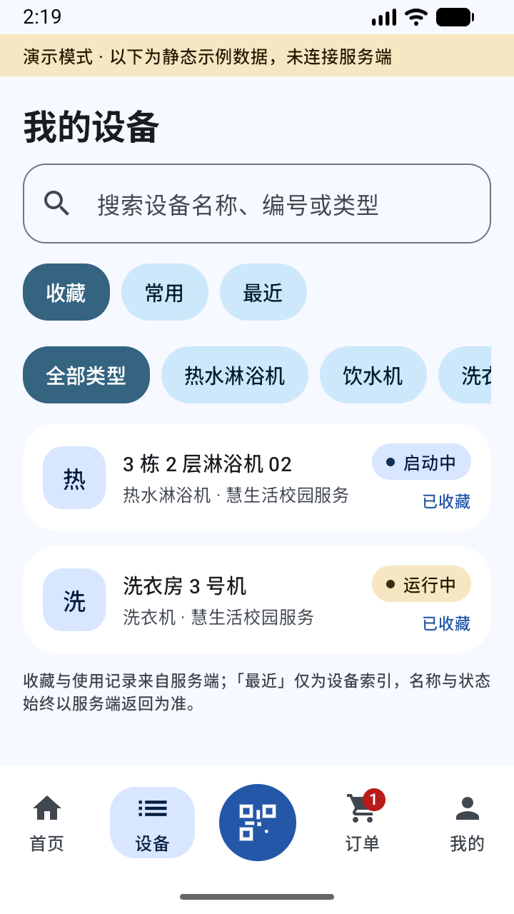
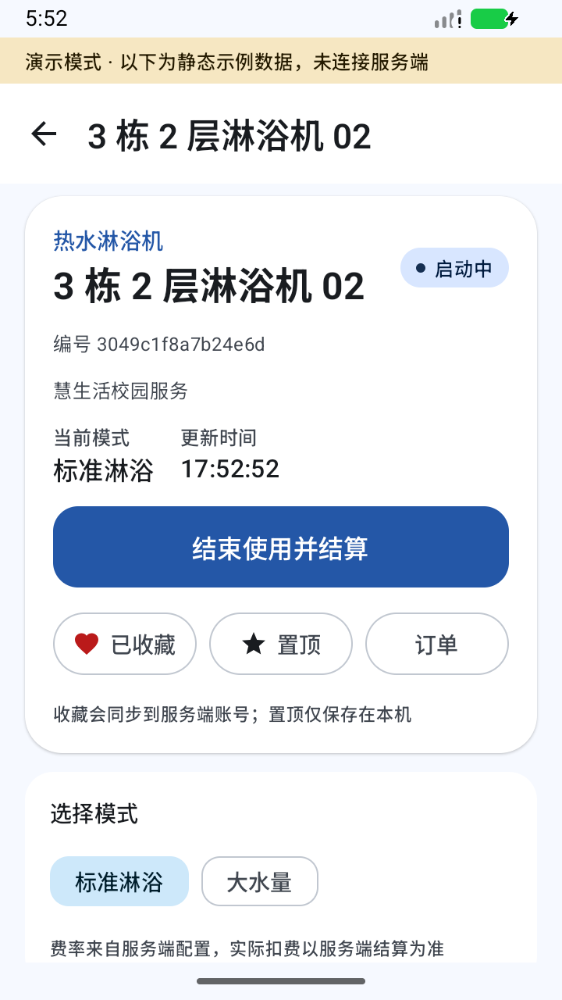
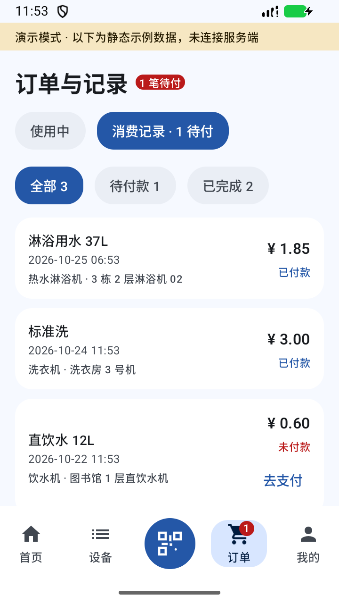
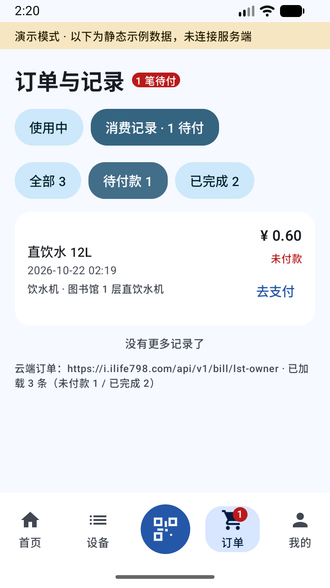
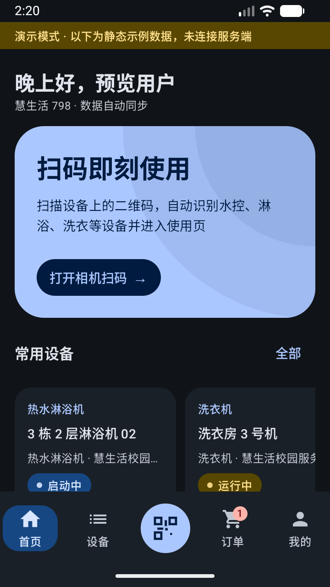
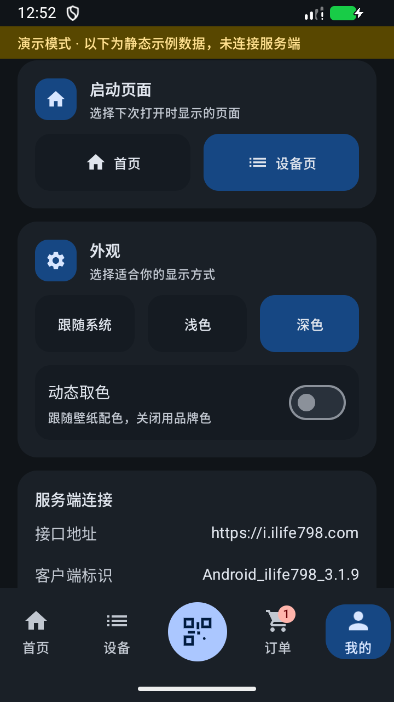

# 慧生活798 · 独立重制客户端

> 基于对原 APK（`com.cloudora.android` v3.1.5）的完整逆向分析，**直接对接官方服务端 `https://i.ilife798.com`** 的全新 Android 客户端。
> 界面、交互、信息架构完全重做（Material 3 Expressive 风格）；登录、扫码/手输编号、设备状态、启停、计费与账单均走原服务端真实接口。
> 内置协议标识保底为 **3.1.9**；运行时优先发现原应用分发页最新版本，缓存有效结果；静态路径基线仍保留 3.1.5。新原包签名、加固限制与更新渠道见 docs/04，不代表已完整恢复 3.1.9 全部协议。

| | |
|---|---|
| 新客户端包名 | `com.smartlife798.app` |
| 当前版本 | `1.7.6`（`versionCode 29`） |
| 技术栈 | Kotlin 2.2 · Jetpack Compose (Material 3) · OkHttp · CameraX + ML Kit · Alipay / WeChat SDK |
| 最低版本 | Android 7.0（API 24） |
| 产物 | [`dist/SmartLife798-1.7.6-debug.apk`](dist/SmartLife798-1.7.6-debug.apk) |

> **首次参与开发请先读 [`AGENTS.md`](AGENTS.md)**（分层规则、硬性约束、常见任务手册、已知陷阱、完成标准），
> 变更记录见 [`CHANGELOG.md`](CHANGELOG.md)，长期路线见 [`docs/06-工程规范与路线图.md`](docs/06-工程规范与路线图.md)。

---

## v1.7.6 更新（深海蓝与指标等宽布局）

- 默认采用深海蓝 `#2457A7`，统一主按钮、品牌卡与流动水滴图标；完整配色见 [视觉系统](docs/02-功能设计与UI方案.md#6-视觉系统)。
- 「我的」钱包、积分、收藏三列等宽且居中，钱包入口及过渡保留。
- 上方 APK 为本地构建；以下远端链接仍指向既有 1.7.0 发布。

## v1.7.0 更新（GitHub 下载与安装）

- 首次启动（无需登录）及返回前台自动检查更新，登录页与「我的」可手动检查；普通更新允许暂缓，强制更新按最低支持版本码限制旧版。新发布附带 CHANGELOG 历史附件，弹窗按版本分段展示当前安装至最新版之间的全部已有日志；旧元数据只展示最新说明并提示历史缺失。
- 点击更新直接下载 GitHub APK，显示进度；校验哈希、包名、版本和签名后自动打开系统安装界面。Android 需要用户确认，首次可能需要允许安装未知来源应用。
- [直接下载 APK](https://github.com/wu-shanglin/Smartlife798/releases/download/v1.7.0/SmartLife798-1.7.0-debug.apk) · [GitHub 仓库](https://github.com/wu-shanglin/Smartlife798) · [下载最新版本](https://github.com/wu-shanglin/Smartlife798/releases/latest)；更新发布配置见 [工程规范](docs/06-工程规范与路线图.md#github-更新发布)。
- 旧版必须先手动安装一次本版；已知强制策略离线仍保留，未收到策略的离线客户端不能被远程拦截。演示模式不检查、不下载、不安装。

详情过渡与校园生活图标继续保留：

- 使用深海蓝「流动水滴」图标，适配传统、自适应与 Android 13 单色桌面图标。
- 设备详情首帧直接显示已知名称、类型和编号，动画中只呈现静态身份卡与占位；请求并行进行，完整信息及业务操作在实际展开后显示，失败保留身份与重试。
- 设备文字随容器统一缩放，移除独立标题层和重复整页淡变；导航刷新移到进场结束后，避免退场列表同时更新。不使用固定延时，保留系统动画倍率与取消等待。
- 官方协议请求头优先采用原应用分发页最新版本，获取失败使用有效缓存与内置保底；不会下载或安装原 APK。仅版本头变化无需重新安装本客户端，字段或业务变化仍须修复。历史版本门禁、启停及账单验证范围见 [docs/04](docs/04-接口契约与变更检测.md)、[docs/05](docs/05-真实支付与计费实测.md)。

更新流程已在 API 36 模拟器使用公开 GitHub Release 完成下载、校验、取消安装、重试安装与版本确认；其余页面的既有验证为演示模式，真机帧率与 Android 13+ 预测性返回仍需复验。物理出水、非零计费、真实支付及签约仍各自待验；下面截图为历史页面示意。

## 文档

1. [逆向分析报告](docs/01-逆向分析报告.md) — APK 盘点、网络协议、106 个接口、二维码协议、设备状态机、数据模型
2. [功能设计与 UI 方案](docs/02-功能设计与UI方案.md) — 功能清单、信息架构、页面与状态、Expressive 视觉系统
3. [技术方案与开发计划](docs/03-技术方案与开发计划.md) — 选型、分层、自动刷新/历史/支付机制、验证矩阵
4. [接口契约与变更检测](docs/04-接口契约与变更检测.md) — 官方文档缺失的结论、契约文件、升级检测脚本
5. [真实支付与计费实测](docs/05-真实支付与计费实测.md) — 支付宝 resultStatus、启停业务码、证据抓取与当前阻塞
6. [工程规范与路线图](docs/06-工程规范与路线图.md) — 编码规范、评审清单、发布流程、后续计划
7. [AGENTS.md](AGENTS.md) — 开发与维护手册（入口文档）
8. 契约数据：[`docs/api-contract.json`](docs/api-contract.json)（106 条基线路径 + 使用中端点）
9. REA 证据包：`evidence/rea-evidence-bundle.json`（未入库；保留原件，历史动态输出不能由静态逆向完整重建）

---

## 已实现（真实接口）

| 能力 | 接口 |
|---|---|
| 图形验证码 / 短信验证码 / 登录登出 | `captcha`、`acc/login/code`、`acc/login`、`acc/logout` |
| 账号与收藏 | `ui/app/master` |
| 扫码 / 手输编号解析 | `qr/use?id=` |
| 设备详情 / 实时状态 | `ui/app/dev/home/1`、`ui/app/dev/status` |
| 启动 / 结束 / 切模式 | `dev/start`、`dev/end`、`dev/mode/start` |
| 收藏 / 取消 | `dev/favo` |
| 消费记录 / 账单详情 | `bill/lst-owner`、`bill/view-full` |
| 账单支付 | `bill/pay/channels`、`trans/prepay/{type}`、`trans/confirm`（支付宝官方 SDK） |
| 钱包余额 | 详情内 `wallet`、`acc/wallet/owner` |
| 启动确认 / 进行中轮询 | `dev/start` 后每 2s 用 `dev/status` 确认设备离开待机（最多约 11s）；进行中每 2s 一次（仅前台、仅运行/启动中的设备；失败或异常状态不轮询，待机立即清除本机记录） |

新增：常用设备（云端次数 + 本机置顶）、最近使用、搜索与类型筛选、统一异常态、深色/浅色/跟随系统、
动态取色、Expressive 动效。

## 验证与限制

- 支付宝/微信 SDK、钱包充值与免密签约入口已实现；云闪付/银行 SDK、门禁硬件及原应用独立业务不迁移。
- 仓库保留的实测证据包含：真实登录/列表查询、`rcp=false` 后设备进入启动状态、结束请求被拒的提示与 0.00 账单。它不能证明物理出水、非零计费、真实扣款或真机签约已通过。
- 微信支付需要开放平台登记的包名、签名、appId 匹配，SDK 接入不等于可完成真实支付。
- 模拟器演示流程、单测、构建与 lint 分别验证不同边界；旧截图和历史 PASS 不代表当前版本重新验收。
- 最新保留的业务证据与待验条件见 [docs/05](docs/05-真实支付与计费实测.md)，维护待办见 [docs/06](docs/06-工程规范与路线图.md)。维护检查不访问真实账号或操作设备；业务验收需单独执行。

## 截图

首页、设备、详情、我的和深色截图已由 1.7.6 模拟器演示数据更新；其余为既有采集，来源与限制见 [截图清单](docs/02-功能设计与UI方案.md#7-界面截图)。

| 登录 | 首页 | 扫码 |
|---|---|---|
|  |  |  |

| 手动输入 | 设备 | 设备详情 |
|---|---|---|
|  |  |  |

| 云端订单 | 未付角标 | 深色模式 |
|---|---|---|
|  |  |  |

| 外观设置 |
|---|
|  |

## 构建与测试

仓库根目录先运行 `python tools/check-repo.py`、`python -m unittest discover -s tools/tests`、`python tools/check-version.py`。

```powershell
cd SmartLife798

# JDK 17+（AGP 8.13）。不要写进 gradle.properties —— 见 AGENTS.md
$env:JAVA_HOME = "C:\Program Files\Android\Android Studio\jbr"

./gradlew.bat :app:testDebugUnitTest --console=plain   # 纯 JVM 单测
./gradlew.bat :app:assembleDebug      --console=plain
./gradlew.bat :app:lint               --console=plain

adb install -r app/build/outputs/apk/debug/app-debug.apk
```

首次构建需要 Android SDK Platform 36 与 Build-Tools 35+，并在 `SmartLife798/local.properties`
里写好 `sdk.dir`（该文件与 `keystore.properties` 均不入库）。

**可选 release 签名**：在 Gradle 根目录放 `SmartLife798/keystore.properties`（`storeFile` 相对该目录）

```properties
storeFile=release.keystore
storePassword=...
keyAlias=...
keyPassword=...
```

缺失时 `assembleRelease` 仍会成功，只是产物未签名。

## 目录

```
AGENTS.md                     开发与维护手册（入口）
CHANGELOG.md                  变更记录
docs/                         6 份文档 + 接口契约
tools/                        仓库检查、工具测试、逆向与版本校验
screenshots/                  界面截图
SmartLife798/                 Android 工程（应用源码 + 单元测试）
dist/                         可安装 APK
慧生活798.apk                 原始样本
jadx_src/ dexmeta/             本地静态分析缓存（可重建）
evidence/                     本地运行证据（保留原件）
_extract/ jadx_res/            按需生成的逆向中间目录
```

> 版本库只跟踪源码、文档、截图、CI 配置与脚本。`慧生活798.apk`、`_extract/`、`jadx_src/`、
> `jadx_res/`、`dexmeta/`、`evidence/`、`dist/*.apk` 等本地文件已在
> `.gitignore` 中排除。静态分析产物可按 [逆向分析报告](docs/01-逆向分析报告.md) 重建；运行证据与发布 APK 须分别保存，不能由原样本恢复。
