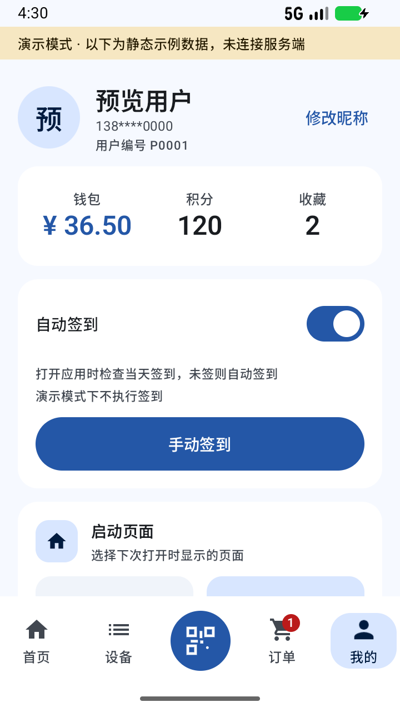
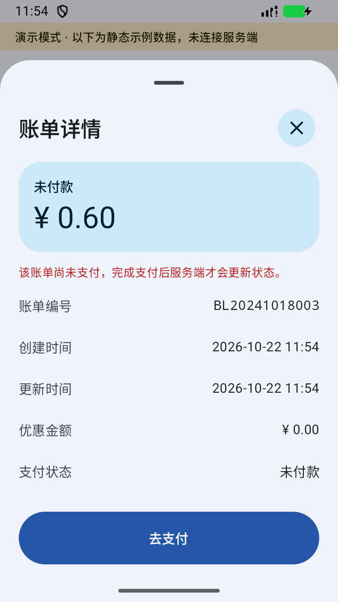

# 慧生活798 · 独立重制客户端

独立重制的中文 Android 客户端，包名 `com.smartlife798.app`，直接访问原服务端 `https://i.ilife798.com`。无官方授权、不含官方源码；界面使用 Kotlin、Jetpack Compose 与 Material 3。

| | |
|---|---|
| 新客户端包名 | `com.smartlife798.app` |
| 当前版本 | `1.17.1`（`versionCode 50`） |
| 技术栈 | Kotlin 2.2 · Jetpack Compose (Material 3 Expressive) · OkHttp · CameraX + ML Kit · Alipay / WeChat SDK |
| 最低版本 | Android 7.0（API 24） |
| 最新已发布 | [1.14.0 APK](https://github.com/wu-shanglin/Smartlife798/releases/download/v1.14.0/SmartLife798-1.14.0-debug.apk) · [Release 说明](https://github.com/wu-shanglin/Smartlife798/releases/tag/v1.14.0) |

客户端发布版本、官方协议请求标识与静态 APK 基线相互独立。运行时从已核验包名和开发者的原应用分发页发现版本，失败保留缓存及内置保底；这不代表新协议或设备兼容性已验，见 [协议维护](docs/04-接口契约与变更检测.md#6-原-apk-版本与更新通道)。

## 当前版本

**1.17.1 / 50 开发构建，尚未远端发布**：共用下拉刷新改用轻量官方指示器，撤回详情额外预取与滚动状态替换；服务端确认当天签到后，重启不再自动查询/提交或重复提示，跨日重新检查，手动刷新仍查询。保留设备占用守卫及已核验的 NFC 长格式入口；支付宝中转短码、真实 NFC 分发及整机流畅度仍有独立验收边界，见 [docs/05](docs/05-真实支付与计费实测.md#9-工程验证记录)。

最新公开版本为 **1.14.0 / 46**，普通更新、最低支持码 37；公开 APK、update.json 与历史附件均已下载核验。[正式 APK](https://github.com/wu-shanglin/Smartlife798/releases/download/v1.14.0/SmartLife798-1.14.0-debug.apk) · [GitHub latest](https://github.com/wu-shanglin/Smartlife798/releases/latest)。

## 功能与边界

官方直接 NFC 链接及内含明确慧生活小程序设备页的支付宝长格式可经服务端确认进入详情；经确认的 NFC 事件在最新详情就绪后自动尝试开始一次，普通链接保持只打开详情。详情按服务端占用用户区分本人和他人，身份不明、他人占用或状态未就绪时禁用操作，命令前重新核对。现有仅含短码的支付宝中转卡仍未取得设备映射，真实 NFC 天线与整机性能尚待实机验收。

登录、收藏、扫码/手输编号、设备状态与启停、消费账单、钱包充值及支付宝/微信 SDK 已实现；执行、金额和支付结果由服务端决定。支持昵称修改、网络头像、设备「使用积分」账号偏好和默认开启的自动签到（「我的」可关闭，并提供手动签到）。签到结果在当前页面提示，先查询当天状态、提交后读回确认；确认后同日重启跳过自动签到请求及重复提示，跨日重新检查；自动不重发当天不明结果，手动可先查询再明确重试；积分设置已在真机保存并恢复；昵称保存仍待验收；3.1.10 签到已在真机确认实际位图及积分入账。微信另受开放平台包名、签名与 appId 配置约束。常用/最近设备、搜索、置顶、启动页和外观偏好属于客户端能力。

范围为中文、手机竖屏；不扩展门禁硬件、考勤、云闪付/银行 SDK 及原应用独立业务。完整页面与功能清单见 [docs/02](docs/02-功能设计与UI方案.md)，已实现不等于真实业务验收通过。

## 维护入口

先读 [AGENTS.md](AGENTS.md)。日常任务按任务分支、验证、Commit、PR/CI、合并及清理执行；打 tag、发布和真实业务操作仍分别授权。

| 需要核对 | 唯一维护位置 |
|---|---|
| 版本历史 | [CHANGELOG](CHANGELOG.md) |
| 原 APK 与协议静态依据 | [docs/01](docs/01-逆向分析报告.md) |
| 页面、交互、视觉与截图来源 | [docs/02](docs/02-功能设计与UI方案.md) |
| 技术选型、运行机制与构建环境 | [docs/03](docs/03-技术方案与开发计划.md) |
| 接口契约、版本发现与漂移检测 | [docs/04](docs/04-接口契约与变更检测.md)、[api-contract.json](docs/api-contract.json) |
| 实测、工程验证及未验边界 | [docs/05](docs/05-真实支付与计费实测.md) |
| 检查命令、存储、发布、待办和 Git | [docs/06](docs/06-工程规范与路线图.md) |

## 构建与产物

唯一 Android 工程为 `SmartLife798/`；先按 [构建与运行](docs/03-技术方案与开发计划.md#4-构建与运行) 准备 JDK/SDK、本机 `local.properties`，再按 [检查与证据](docs/06-工程规范与路线图.md#2-检查与证据) 执行适用检查。可选 release 签名及产物准备见 [版本与发布](docs/06-工程规范与路线图.md#3-版本与发布)。

| 本地构建 | 文件 |
|---|---|
| 产物 | [`dist/SmartLife798-1.17.1-debug.apk`](dist/SmartLife798-1.17.1-debug.apk) |

原 APK、静态分析缓存、`evidence/` 及 APK 不入库。原样本、签名、本机配置、当前交付和独有证据须保留；清理规则见 [文档与目录维护](docs/06-工程规范与路线图.md#4-文档与目录维护)。

## 截图

截图来源、版本及限制统一见 [截图清单](docs/02-功能设计与UI方案.md#7-界面截图)；订单、待付款和账单详情为 1.11.0 演示构建；首页、设备、设备详情、我的及深色页保留 1.10.0，登录、扫码与手输保留 1.8.0 历史图。演示截图不能作为真实业务验收。

| 登录 | 首页 | 扫码 |
|---|---|---|
|  |  |  |

| 手动输入 | 设备 | 设备详情 |
|---|---|---|
|  |  |  |

| 消费记录 | 待付款筛选与角标 | 我的 |
|---|---|---|
|  |  |  |

| 账单详情（演示，不执行支付） |
|---|
|  |

| 深色首页 | 外观（演示内深色选择） |
|---|---|
|  |  |
